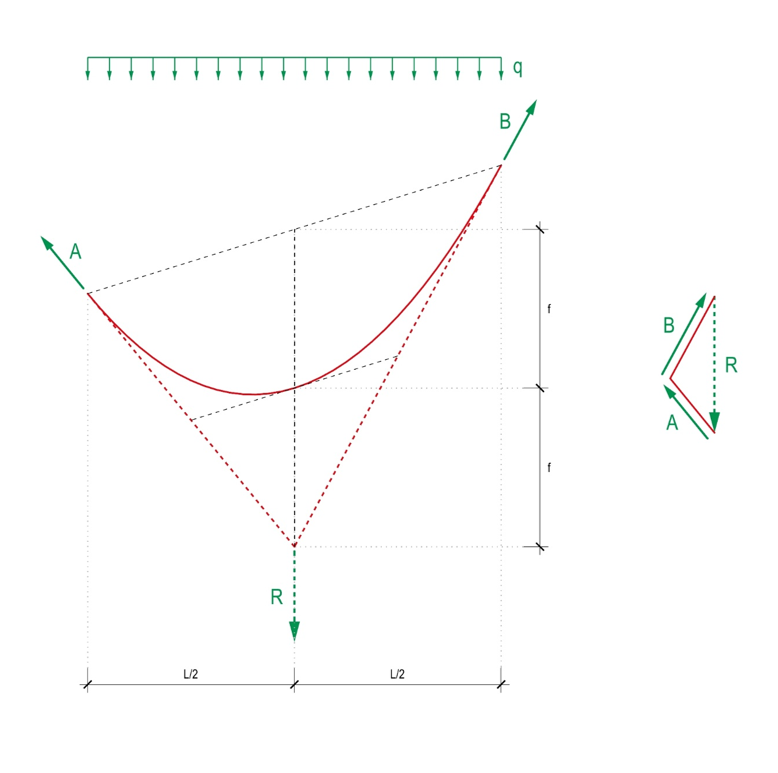

# Uniformly Distributed Loads

<figure><figcaption></figcaption></figure>

The loads acting on your structural model can be either point loads, as we have worked with throughout the semester, or uniformly distributed loads.

The funicular shape of a structure in tension or compression subjected to a uniformly distributed vertical load per unit of horizontal length is a **parabola**.

The parabola has a useful geometric property: the tangents at its two ends intersect on the vertical line passing through the midpoint of its horizontal span. This coincides with the line of action of the resultant of the distributed load.

This property allows us to determine the support reactions using Graphic Statics by solving the equilibrium of three concurrent forces.

For your individual project, you can use this property to construct interactive parabolic funicular structures in Grasshopper:

1. Solve the equilibrium of the node defined by the two end tangents and the line of action of the resultant (R = q · L, where q is the distributed load per unit of horizontal length and L is the horizontal span).
2. Construct the parabola using the **Nurbs Curve** component with degree 2, three control points (support A, the intersection of the tangents, and support B), and the periodic option set to False.

This approach allows you to work with uniformly distributed loads without discretizing them into individual point loads.

